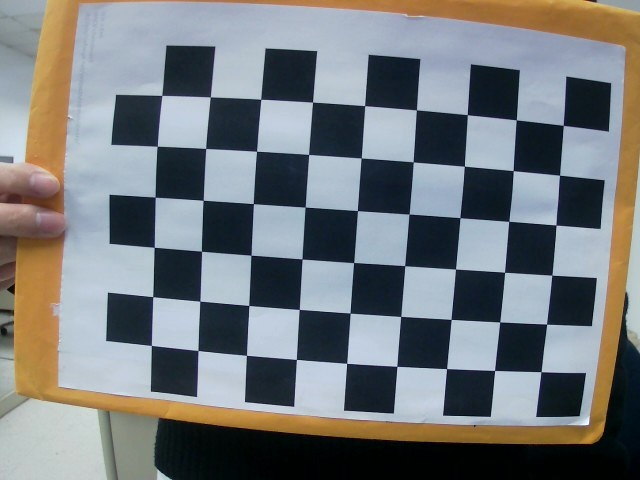

# Camera Calibration and Lens Distortion Correction

C++ と OpenCV を使用し、チェスボード画像からカメラの内部パラメータとレンズの歪み係数を推定して、画像の歪みを補正するプロジェクトです。

## デモ動画

[実行デモを見る](https://youtu.be/eSzptpMv1zw)

前半ではチェスボードのコーナー検出、後半では元画像と歪み補正後の画像を表示します。

## サンプル画像



※ 上の画像は補正前の入力画像です。

## 主な機能

- 複数のチェスボード画像の読み込み
- チェスボードの内部コーナー検出
- 検出したコーナーの可視化
- カメラの内部パラメータと歪み係数の推定
- 元画像と歪み補正後の画像の表示

## 処理の流れ

1. `testdata.txt` から画像ファイル名を読み込みます。
2. 各画像をグレースケールに変換します。
3. `findChessboardCorners()` でチェスボードのコーナーを検出します。
4. 検出した画像上の座標と、チェスボード上の3次元座標を対応付けます。
5. `calibrateCamera()` でカメラの内部パラメータと歪み係数を推定します。
6. `undistort()` で画像の歪みを補正し、結果を表示します。

本プロジェクトは一般的なカメラモデルを使用しています。
`cv::fisheye` による魚眼カメラ専用のキャリブレーションは実装していません。

## 開発環境

| 項目 | 内容 |
|---|---|
| OS | Windows |
| 言語 | C++ |
| IDE | Visual Studio 2019 |
| ツールセット | v142 |
| ライブラリ | OpenCV 4.5.4 |
| ビルド構成 | Debug / x64 |

## ファイル構成

```text
opencv-camera-calibration/
├── README.md
├── .gitignore
├── 01.sln
└── 01/
    ├── 01.vcxproj
    ├── Source2.cpp
    ├── testdata.txt
    └── 1_L.jpg ～ 10_L.jpg
```

## セットアップ

### 1. 必要なソフトウェアのインストール

- Visual Studio の「C++ によるデスクトップ開発」
- MSVC v142 ビルドツール
- [OpenCV 4.5.4 の Windows 版](https://github.com/opencv/opencv/releases/tag/4.5.4)

Visual Studio 2022 を使用する場合は、v142 ビルドツールを追加するか、使用可能なツールセットにプロジェクトを変更してください。

### 2. OpenCV のパス設定

元のプロジェクトでは、OpenCV を以下の場所に配置しています。

```text
C:\opencv\build
```

Visual Studio でプロジェクトのプロパティを開き、構成を **Debug / x64** に設定して、以下の項目を確認してください。

| 設定項目 | 値 |
|---|---|
| インクルード ディレクトリ | `C:\opencv\build\include` |
| ライブラリ ディレクトリ | `C:\opencv\build\x64\vc15\lib` |
| リンカーの追加の依存ファイル | `opencv_world454d.lib` |

OpenCV の配置先が異なる場合は、パスを実際のインストール先に変更してください。

### 3. 実行時の DLL 設定

次のフォルダーを Windows の環境変数 `Path` に追加し、Visual Studio を再起動してください。

```text
C:\opencv\build\x64\vc15\bin
```

または、`opencv_world454d.dll` をビルドした実行ファイルと同じフォルダーにコピーしてください。

## 実行方法

1. `01.sln` を Visual Studio で開きます。
2. ビルド構成を **Debug / x64** に設定します。
3. プロジェクトの「プロパティ → デバッグ → 作業ディレクトリ」を `$(ProjectDir)` に設定します。
4. プロジェクトをビルドして実行します。
5. 画像ウィンドウで任意のキーを押すと、次の処理に進みます。

画像と `testdata.txt` は `01/` フォルダーに配置してください。

歪み補正の段階では、`image` ウィンドウに元画像、`undistort image` ウィンドウに補正後の画像が表示されます。

## キャリブレーションの設定

| パラメータ | 設定値 |
|---|---|
| チェスボードの内部コーナー数 | 横6 × 縦9 |
| マスの幅 | 10 |
| マスの高さ | 10 |

内部コーナー数は、チェスボードのマスの数とは異なります。

マスの幅と高さは、実際に使用するチェスボードの寸法に合わせて変更してください。単位は統一する必要があります。

## 現在の制限

- OpenCV の設定は Debug / x64 のみです。
- キャリブレーション結果のファイル保存は実装していません。
- 再投影誤差の出力や、サブピクセル精度でのコーナー調整は実装していません。
- 画像を読み込めない場合や、有効な検出結果が不足する場合のエラー処理は改善の余地があります。
- 補正結果は画面に表示され、画像ファイルには保存されません。

## 素材・ライセンス

画像などの素材を再利用する場合は、それぞれの利用条件を確認してください。
本リポジトリのライセンスは未設定です。